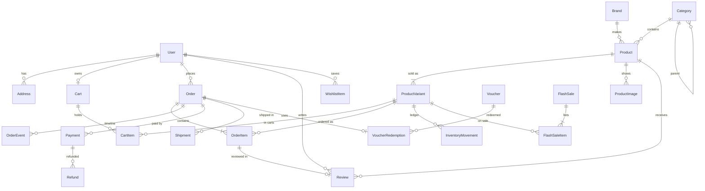

# TokoTech data model

**Updated 16 Nov 2026** · PostgreSQL 18 · Prisma 7.10
Source of truth: [`prisma/schema.prisma`](../prisma/schema.prisma) · migration: [`prisma/migrations/20261116000000_init`](../prisma/migrations/20261116000000_init/migration.sql) · seed: [`prisma/seed.ts`](../prisma/seed.ts)

28 models, 11 enums, 16 CHECK constraints. Migrations: `init` (tables, indexes, CHECKs) and `search_trgm` (pg_trgm + trigram index on product names). This document explains *why* the schema looks the way it does; the schema file has the exact fields.

---

## 1. Conventions

| Rule | Detail |
|---|---|
| **Money** | `Int` in whole Rupiah (IDR has no minor unit). Max ≈ Rp 2.1 billion per value; revisit as `BigInt` only if B2B is added. Prices include PPN 11%; `Order.tax` stores the included amount for invoices. |
| **IDs** | `String` with `cuid()` default. Fixtures use readable ids (`p-001`, `u-001`, `o-1000`) so the seed keeps relations intact. Human-facing numbers are separate unique columns: `Order.number` (`TT-260311`), `Payment.number` (`PAY-908412`). |
| **Names** | Tables are snake_case via `@@map` (`product_variants`); columns keep Prisma's camelCase (`"compareAtPrice"`). |
| **Snapshots** | Orders copy everything they display (product name, SKU, variant name, unit price, full shipping address), so catalog or address edits never rewrite history. |
| **Denormalized fields** | `Product.priceFrom`, `compareAtFrom`, `totalStock`, `ratingAvg`, `ratingCount`, `soldCount` exist for listing sort/filter without joins. They are maintained on write (Phase 3) and recomputed by `syncDenormalized()` in the fixtures. |
| **Derived, not stored** | Product badges (`new`, `sale`, `bestseller`, `preorder`), colours (from variant options), "verified purchase" (all reviews are). |
| **Codes, not labels** | Gateway and courier codes are stored machine-readable (`bca_va`, `jne` + `yes`). `lib/format.ts` turns them into display text (`providerLabel`, `courierLabel`, `PAYMENT_METHOD_LABEL`). |

---

## 2. Overview



| Area | Models |
|---|---|
| Identity | `User`, `Address`, and the Auth.js tables `Account`, `Session`, `VerificationToken` |
| Catalog | `Category`, `Brand`, `Product`, `ProductVariant`, `ProductImage`, `Review` |
| Shopping | `Cart`, `CartItem`, `WishlistItem`, `StockAlert` |
| Orders | `Order`, `OrderItem`, `OrderEvent`, `Payment`, `Refund`, `Shipment` |
| Promotions | `Voucher`, `VoucherRedemption`, `FlashSale`, `FlashSaleItem` |
| Operations | `InventoryMovement`, `AuditLog`, `NewsletterSubscriber` |

---

## 3. Enums

| Enum | Values | Notes |
|---|---|---|
| `Role` | `CUSTOMER` `STAFF` `ADMIN` | Staff manage products and orders; admins also payments and users |
| `UserStatus` | `ACTIVE` `INVITED` `SUSPENDED` | `INVITED` = staff invite not yet accepted |
| `ProductStatus` | `DRAFT` `ACTIVE` `ARCHIVED` | The storefront only ever shows `ACTIVE` |
| `ReviewStatus` | `PENDING` `PUBLISHED` `HIDDEN` | New reviews start `PENDING` (moderation queue) |
| `OrderStatus` | `PENDING_PAYMENT` `PAID` `PROCESSING` `SHIPPED` `DELIVERED` `CANCELLED` `RETURNED` | See the lifecycle below |
| `PaymentMethod` | `QRIS` `VIRTUAL_ACCOUNT` `CREDIT_CARD` `EWALLET` | `Payment.provider` holds the bank/wallet code |
| `PaymentStatus` | `PENDING` `PAID` `FAILED` `EXPIRED` `REFUNDED` `PARTIALLY_REFUNDED` | Mapped from Midtrans `transaction_status` |
| `RefundStatus` | `REQUESTED` `PROCESSING` `SUCCEEDED` `FAILED` | |
| `ShipmentStatus` | `PENDING` `PICKED_UP` `IN_TRANSIT` `DELIVERED` `FAILED` `RETURNED` | Updated by the aggregator's tracking webhook |
| `VoucherType` | `PERCENT` `FIXED` `FREE_SHIPPING` | |
| `InventoryReason` | `RESTOCK` `SALE` `RESERVATION` `RESERVATION_RELEASE` `RETURN` `ADJUSTMENT` | |

---

## 4. Models by area

### Identity

| Model | Purpose | Key points |
|---|---|---|
| `User` | Shoppers and staff | `email` unique; `passwordHash` null for OAuth/OTP accounts; `role` + `status` indexed together; `locale` (`en`/`id`) drives the bilingual UI |
| `Address` | Saved shipping addresses | `district` (kecamatan) is **required** because courier rates need it. `areaId` is the aggregator's area id from autocomplete; `latitude`/`longitude` for instant couriers (GoSend/Grab). One `isDefault` per user |
| `Account`, `Session`, `VerificationToken` | Auth.js adapter tables | `VerificationToken` also carries staff invites |

### Catalog

| Model | Purpose | Key points |
|---|---|---|
| `Category` | Menu tree + filter config | `facets` (Json): `[{ key, label, type: "checkbox" \| "chips", order? }]`. Each `key` matches a key in `Product.specs`; the filter UI renders from this. `parentId` allows a tree (flat today) |
| `Brand` | Manufacturer | `color` is the fallback wordmark colour until `logoUrl` exists |
| `Product` | What a customer browses | `specs` (Json, **GIN `jsonb_path_ops` index**) holds the facet values, e.g. `{ "refresh": "240Hz", "panel": "OLED" }`, queried with `specs @> '{"refresh":"240Hz"}'`. `details` is the full spec table. Denormalized `priceFrom`/`compareAtFrom` (cheapest active variant), `totalStock` (Σ stock − reserved), ratings, `soldCount` |
| `ProductVariant` | What a customer buys | **Owns price, stock and SKU.** `options` (Json) e.g. `{ "ram": "32GB", "storage": "1TB", "color": "White" }`. Every product has ≥ 1 variant. `reserved` = units held by unpaid orders. Packed `weightGrams` + box size in cm for courier rates (volumetric weight matters for PCs and monitors) |
| `ProductImage` | Gallery | Optional `variantId` for colour-specific images |
| `Review` | Buyer reviews | `orderItemId` **required and unique**: one review per purchased item, only by the buyer. Starts `PENDING`; `moderatedById`, `moderatedAt`, `moderationNote` record the decision. Only `PUBLISHED` reviews count toward `Product.ratingAvg` |

### Shopping

| Model | Purpose | Key points |
|---|---|---|
| `Cart` | One per user or guest | `userId` **or** `guestToken` (cookie), enforced by a CHECK; merged into the user cart on sign-in. Optional applied `voucherId` |
| `CartItem` | A variant + quantity | Unique per (`cartId`, `variantId`). The client store mirrors this shape (`{ variantId, quantity }`) |
| `WishlistItem` | Saved products | Composite key (`userId`, `productId`): wishlists are per product, not per variant |
| `StockAlert` | "Notify me when back in stock" | `notifiedAt` set when the email goes out |

### Orders, payments, fulfilment

| Model | Purpose | Key points |
|---|---|---|
| `Order` | One checkout | `userId` optional (**guest checkout**); `email` always set; `guestAccessToken` for the guest order link. Shipping address snapshot (`ship*`, including `shipAreaId` and coordinates). Money snapshot: `total = subtotal − discount + shippingFee` (CHECK). `expiresAt` copied from the active payment; index on (`status`, `expiresAt`) for the expiry sweeper |
| `OrderItem` | Line snapshot | `productName`, `productSlug`, `variantName`, `sku`, `unitPrice`, `lineTotal = unitPrice × quantity` (CHECK). `variantId` is `SetNull` on delete so history survives. `flashSaleItemId` when the price came from a flash sale |
| `OrderEvent` | Status timeline | Shown on the order page and in admin; `actorId` null for system/gateway events |
| `Payment` | One Midtrans attempt | `number` is sent as the Midtrans `order_id` (unique per attempt, so a retry after expiry is a new row); `gatewayRef` = `transaction_id` (unique, the **webhook idempotency key**); `snapToken`, `fraudStatus`, `vaNumber`, `qrString`, `redirectUrl`, `expiresAt`, gateway `fee`, last verified notification in `raw` |
| `Refund` | Money back | Issued by an admin (`issuedById`) from the payment drawer; returns themselves are handled by support |
| `Shipment` | Courier booking | `provider` = aggregator (`biteship` / `rajaongkir`), `courier` + `service` codes, `externalId` (tracking-webhook key), `trackingNumber` (waybill/resi), quoted `cost`, billed `weightGrams` = max(actual, volumetric) |

### Promotions

| Model | Purpose | Key points |
|---|---|---|
| `Voucher` | Discount code | `code` stored uppercase; `PERCENT` (1–100, with `maxDiscount` cap), `FIXED` (IDR) or `FREE_SHIPPING`; `minSubtotal`, window, `usageLimit` total and `perUserLimit`; `usedCount` |
| `VoucherRedemption` | Usage record | One per order (`orderId` unique); written when the order is **paid**, so unpaid orders don't burn a use |
| `FlashSale` / `FlashSaleItem` | Time-boxed deals | Item per variant with `salePrice`, `quota` and `sold` (`sold ≤ quota`, CHECK); the checkout transaction increments `sold` |

### Operations

| Model | Purpose | Key points |
|---|---|---|
| `InventoryMovement` | Append-only stock ledger | `delta` + `reason` (+ `orderId` / `actorId`). Σ `delta` per variant = `stock − reserved` (what can still be sold) |
| `AuditLog` | Admin write history | `action` (`product.update`, `payment.refund`, `user.role_change`), `entity` + `entityId`, `changes` as `{ field: [before, after] }` |
| `NewsletterSubscriber` | Footer sign-up | Double opt-in via `confirmedAt` |

---

## 5. Lifecycles

### Order + payment

```
checkout ─► PENDING_PAYMENT ──paid──► PAID ─► PROCESSING ─► SHIPPED ─► DELIVERED ─► (RETURNED)
   │  stock reserved                 │ reservation → sale          shipment IN_TRANSIT   refund via admin
   │                                 │ voucher redeemed
   └──payment EXPIRED / FAILED──► CANCELLED  (reservation released)
```

| Step | Stock | Rows written |
|---|---|---|
| Checkout | `reserved += qty` where `stock − reserved ≥ qty` (conditional update, no overselling) | `Order`, `OrderItem`s, `OrderEvent`, `Payment` (PENDING), `InventoryMovement` RESERVATION (−qty) |
| Paid (webhook) | `reserved −= qty`, `stock −= qty` | Payment → PAID, `OrderEvent`, RESERVATION_RELEASE (+qty) and SALE (−qty) movements, `VoucherRedemption`, `FlashSaleItem.sold` |
| Expired / failed | `reserved −= qty` | Payment → EXPIRED/FAILED, Order → CANCELLED, RESERVATION_RELEASE (+qty) |
| Returned | `stock += qty` if resellable | `Refund`, Payment → REFUNDED, Order → RETURNED, RETURN movement |

Payment windows (Midtrans): QRIS and cards 1 hour, e-wallets 15 minutes, virtual accounts 24 hours. The order holds stock for exactly that long (`Order.expiresAt`).

### Review

`DELIVERED` order item → buyer submits → `PENDING` → staff publishes (`PUBLISHED`, counts toward the rating) or hides it with a note (`HIDDEN`).

---

## 6. Database constraints

Added by hand at the end of the init migration (Prisma can't express them). `prisma/seed.ts` validates the fixtures against the same rules before inserting.

| Table | Rule |
|---|---|
| `product_variants` | `reserved ≥ 0`, `stock ≥ reserved`; `price > 0`; `compareAtPrice` null or `> price`; `weightGrams > 0` |
| `products` | `ratingAvg` between 0 and 5, `ratingCount ≥ 0` |
| `cart_items`, `order_items` | `quantity > 0`; `lineTotal = unitPrice × quantity` |
| `orders` | money ≥ 0; `total = subtotal − discount + shippingFee` |
| `payments`, `refunds` | `amount ≥ 0` / `> 0`, `fee ≥ 0` |
| `reviews` | `rating` between 1 and 5 |
| `vouchers` | `value ≥ 0`, PERCENT between 1 and 100, `perUserLimit ≥ 1` |
| `flash_sales`, `flash_sale_items` | `endsAt > startsAt`; `salePrice > 0`; `sold ≤ quota` |
| `carts` | `userId` or `guestToken` is set |

Indexes beyond primary/unique keys: products by (category, status), (status, priceFrom), (status, soldCount), (status, publishedAt) and the GIN index on `specs`; reviews by (product, status, createdAt) and the moderation queue (status, createdAt); orders by (user, placedAt), email, (status, placedAt), (status, expiresAt); payments by (status, createdAt).

---

## 7. How the app uses it

```
prisma/schema.prisma ──generate──► lib/generated/prisma (client + types)
                                          │
lib/types.ts  ◄── Serialized<Model>: same fields, Date → ISO string, Json → concrete shape
                                          │
prisma/fixtures/*.ts (typed as those models) ──► prisma/seed.ts ──► Postgres
                                                                       │
                       lib/db.ts (PrismaClient + @prisma/adapter-pg) ◄─┘
                                          │
        lib/data/index.ts ("use cache" reads; the only data boundary)
          │                         │                         │
   server pages            GET /api/catalog            GET /api/search
                       (cart, wishlist, compare)      (header suggestions)
   lib/actions/voucher.ts (server action: validate a voucher code)
```

- **Types are derived from the schema.** `lib/types.ts` maps each generated model through `Serialized<T>` (dates become ISO strings because data crosses the server→client boundary as JSON) and narrows Json columns (`specs`, `facets`, `options`). A schema change the fixtures or UI don't follow fails `tsc`.
- **Fixtures are only the seed.** `prisma/fixtures/*` feed `prisma/seed.ts`; nothing in the app imports them.
- **Listing queries run in SQL** (`getProducts`): JSONB containment filters on `specs` (GIN index), facet counts "excluding self" with `count(*) FILTER (WHERE …)`, the price histogram with `width_bucket`, sorting and pagination.
- **Search is typo-tolerant**: every term must match the name/brand/category/spec text as a substring or with `word_similarity ≥ 0.45` (pg_trgm, migration `search_trgm`).
- **Caching**: every read is `"use cache"` with `cacheLife` and tags (`catalog`, `product:<slug>`, `reviews:<productId>`, `orders:<userId>`, `admin`) so Phase 3 writes can call `revalidateTag`. Re-seeding doesn't revalidate: restart the server (or rebuild) after `db:seed`.
- **Admin tables read projections** (`AdminProductRow`, `AdminUserRow`, `AdminPaymentRow` in `lib/types.ts`), each one Prisma select/aggregate. KPIs and charts are `GROUP BY` queries over paid orders, by day in WIB.
- **Signed-in user**: `lib/session.ts` fixes it to Rofi (`u-001`) until Auth.js (Phase 3.1); account functions take the user id as an argument.

### Seed contents

| Data | Rows | Notes |
|---|---|---|
| Users / addresses | 24 / 23 | `u-001` Rofi (ADMIN, also the signed-in shopper, 2 addresses); 2 admins, 2 staff, 2 suspended, 2 invited (no address) |
| Categories / brands | 7 / 14 | Facet configs per category |
| Products / variants | 56 / 96 | 52 ACTIVE, 3 DRAFT, 1 ARCHIVED. Variants per colour; Zephyrus G16, Zenbook 14 and Vanguard RTX 5070 have price-changing RAM/storage configs |
| Orders / items / payments | 106 / 262 / 106 | Rofi's 4 orders; 48 store orders over the last 30 days (3 awaiting payment with stock held, failed, expired, refunded); 54 delivered history orders |
| Shipments / refunds | 90 / 2 | Biteship provider, JNE / SiCepat / GoSend |
| Reviews | 156 | 3 per live product, each tied to a delivered history item; 135 published, the rest pending or hidden |
| Vouchers | 3 | `TOKOTECH10` (10%, max Rp 500 rb), `GRATISONGKIR` (free shipping over Rp 1 jt), `HEMAT100K` (ended) |
| Flash sale | 1 sale, 10 items | Today's sale on the most-discounted variants |
| Stock ledger | 97 movements | Opening balance per variant + 3 order holds |

The data is deterministic (seeded PRNG, fixed "now" of 16 Nov 2026 in `prisma/fixtures/clock.ts`), so every seed run produces the same database. The app itself uses the real clock ("new" badges, the running flash sale, the 30-day charts).

---

## 8. Commands

```bash
npm run db:generate   # regenerate the client (also runs on npm install)
npm run db:migrate    # prisma migrate dev: create/apply a migration after editing the schema
npm run db:deploy     # apply existing migrations (CI / fresh machine)
npm run db:seed       # truncate + load the fixtures (repeatable)
npm run db:reset      # drop, re-migrate, re-seed
npm run db:studio     # browse the data
npx tsx prisma/seed.ts --check   # validate fixtures only, no database needed
```

`DATABASE_URL` lives in `.env` (template: `.env.example`) and is read by `prisma.config.ts`. Locally it points at a dedicated `tokotech` role and database on the PostgreSQL 18 install; `docker-compose.yml` provides the same for machines without one.

When you add a migration that needs a CHECK constraint, use `npm run db:migrate -- --create-only`, append the SQL to the generated file, then apply it.
